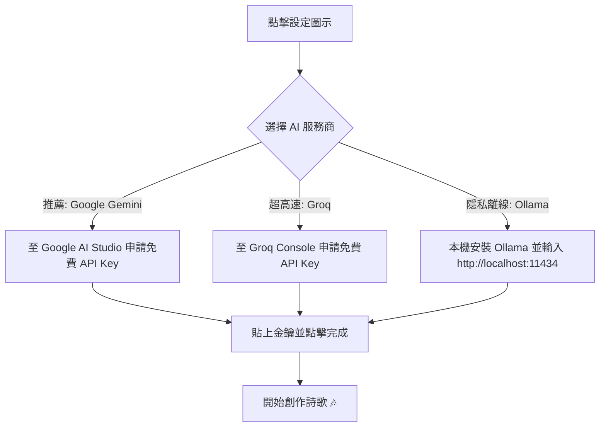

# 🎵 粵語詩歌填詞工作室 (Cantonese Lyric Studio)

<p align="center">
  
  
  
  
  
  <a href="https://buymeacoffee.com/akworkshop" target="_blank">
    
  </a>
</p>

<p align="center">
  <b>基於「0243 填詞法」的智能粵語基督教詩歌創作平台</b><br/>
  死守原曲音階，同義靈動換詞。告別廣東話「倒音」困擾，幫助創作者更有效創作更多感動人心的原創詩歌，同心榮耀神！
</p>

---

## 📖 專案介紹 (Introduction)

粵語擁有「九聲六調」，若歌詞聲調與旋律走向不吻合，便會出現嚴重的「倒音（音不協）」現象，甚至產生尷尬歧義。傳統廣東話填詞講究「**0243 協音法**」，將粵語聲調簡化為四個階梯，讓詞曲完美合一。

**Cantonese Lyric Studio（粵語詩歌填詞工作室）** 專為基督教敬拜者、填詞人及音樂事工團隊而設計。結合了現代 AI（Gemini、Groq、Ollama）與權威的粵語字音檢驗引擎（`to-jyutping` + 本地 3,800+ 聖經神學詞庫），實現 **100% 嚴格音階對位、全自動精準驗證、跨設備雲端同步**！


---

## 🎼 什麼是「0243 填詞法」？

在粵語填詞實務中，數字 `0, 2, 4, 3` 代表由低至高的四個音階：

| 音階代號 | 相對音高 | 對應粵語九聲 | 詩歌填詞特性與常見字例 |
| :---: | :---: | :---: | :--- |
| **0** | **最低音** | **陽平**（第 4 聲） | 沉穩、厚重。<br/>*例字：神、王、靈、同、行、人、慈、情、懷、長、微* |
| **2** | **中低音** | **陽去 / 陽上 / 陽入**（第 5, 6 聲） | 承接、平穩、順暢。<br/>*例字：在、大、是、地、道、美、父、命、順、靜、夜、浪* |
| **4** | **次高音** | **陰去 / 中入**（第 3 聲）<br/>*及「我、你、祢」* | 深情、傾訴、高揚。<br/>*例字：我、你、祢、愛、信、靠、向、救、盼、獻、聖、更(更加)* |
| **3** | **最高音** | **陰平 / 陰上 / 陰入**（第 1, 2 聲） | 嘹亮、清脆、頂峰。<br/>*例字：主、祂、天、深、心、歡、彰、歌、尊、基、督、因* |

> 💡 **音階記憶口訣**：可以用經典粵語字句「**願(2) 主(3) 賜(4) 恩(3) 我(4) 心(3) 仰(2) 望(2) 神(0)**」來感受音調起伏！

---

## ✨ 核心特色 (Key Features)

- 🎯 **100% 協音驗證系統**：
  內建廣東話拼音引擎，每輸入一個字即時標註「粵拼」與「實際音階」，自動判定是否有失音（`綠色 🟢 鎖定`、`粉紅 🔴 要求重寫`、`金黃 🟡 唔啱音`）。
- 🤖 **大師級 AI 填詞（多模型支援）**：
  - 支援 **Google Gemini**（Gemini 2.5 Flash / 1.5 Pro）
  - 支援 **Groq** 超高速開源模型（Llama 3.3 70B）
  - 支援 **Ollama** 本地完全離線運算
  - 內建 **本地抒情神學詞庫**，即使不連 AI 也能一鍵生成！
- 📜 **豐富的聖經人物與神學典故詞庫**：
  涵蓋約書亞、迦勒、大衛、摩西、亞伯拉罕、但以理、保羅等經典信心榜樣，以及「十字架、寶血、救贖、磐石、高台、避難所」等神聖屬性。
- 📱 **手機端極致體驗**：
  - **左右滑動手勢（Swipe Left / Right）**：以 300ms App 級平滑動畫在「歌曲設定」與「填詞畫布」之間自由切換。
  - **自動多行折行（Flex Wrap）**：句子再長也不會移出螢幕，告別橫向滑動編輯的麻煩。
  - **極簡頂部工具列**：整合行動端快捷按鈕與彈出式功能選單。
- ☁️ **跨裝置雲端同步（Supabase）**：
  支援 Google One Tap / Google OAuth / Email 帳號登入，在手機、平板與電腦隨時同步專案。
- 🎙️ **歌唱發音工學提示（Vocal Ergonomics）**：
  提示開口韻、閉口鼻音（-m/-n/-ng）或塞音（-p/-t/-k），高音句尾優先推薦寬開口韻（如 -aa, -oeng），讓會眾更易唱、聲音更宏亮。

---

## 🚀 快速使用教程 (Step-by-Step Tutorial)

### 步驟 1：輸入旋律音階（0243 譜）
在左側「**0243 旋律音階**」欄位輸入你的歌曲旋律節奏，詞組之間請用**空格**隔開，每行代表一句：
```text
2342 433
2442 0222
```

### 步驟 2：設定歌名與屬靈故事
填寫「**詩歌名稱**」與「**歌曲含意 / 想表達的故事**」：
- *例如：「鼓勵青年信徒如約書亞般剛強壯膽，無懼風浪，跨過約旦河進入應許之地。」*
- 💡 **提示**：故事描述越豐富，AI 創作出的歌詞就越有畫面感與靈命深度！

### 步驟 3：AI 生成連貫歌詞
點擊 **`[ ✨ AI 生成連貫歌詞 ]`**（或使用內建詞庫），系統將在 3～5 秒內創作出完全協音且意境優美的初稿。

### 步驟 4：歌詞互動精修
在中央畫布點擊任何詞組：
1. **就地換詞**：瀏覽「✨ AI 主題造句候選」或「📚 本地詞庫推薦」，點擊即可秒速替換。
2. **鎖定心儀字句**：滿意的詞點擊 `鎖定保留`（標記為綠色 🟢），再次生成時 AI 會嚴格保留這些字。
3. **標記重寫**：覺得不夠自然的詞點擊 `要求重寫`（標記為紅色 🔴）。
4. **直接打字修改**：點擊 `直接打字`（或雙擊卡片），直接手動輸入文字。

---

## ⚙️ API 設定方法 (API Configuration)

本工具支援自備 API Key，所有金鑰**僅儲存在你的瀏覽器本機 LocalStorage**，不會上傳到任何第三方伺服器，安全無虞。

點擊頂部 **`模型：GEMINI`** 按鈕（或手機選單中的 **`AI 模型與金鑰設定`**）：



### 1. Google Gemini（最推薦，詞意深邃優美）
1. 前往 [Google AI Studio](https://aistudio.google.com/app/apikey) 免費申請 API Key。
2. 在設定中選擇 **Google Gemini**。
3. 貼上你的 API Key，推薦選擇 `gemini-2.5-flash` 或 `gemini-1.5-pro`。

### 2. Groq（生成速度極快，毫秒級回應）
1. 前往 [Groq Console](https://console.groq.com/keys) 免費建立 API Key。
2. 在設定中選擇 **Groq (Llama 3)**。
3. 推薦使用 `llama-3.3-70b-versatile` 模型。

### 3. Ollama（本機完全離線私有化）
1. 下載並安裝 [Ollama](https://ollama.ai/)。
2. 終端機執行 `ollama run qwen2.5:7b` 或 `ollama run llama3.1`。
3. 在設定中填入位址（預設為 `http://localhost:11434`）即可！

---

## ❓ 常見問題解答 (FAQ)

<details>
<summary><b>Q1: 為什麼廣東話詩歌一定要講究「協音」？</b></summary>

廣東話是聲調語言，字音本身帶有音高升降。如果旋律往上走，但歌詞字音往下掉（例如想唱「主」，卻填了「豬」或「住」的音階），聽眾聽起來就會變成另一個字，這就是「倒音」。協音讓歌唱者能夠毫不費力地自然吐字，聽眾一聽就能明白歌詞所傳遞的福音與信息。
</details>

<details>
<summary><b>Q2: 「我、你、祢」在 0243 中為什麼歸入 4 聲（次高音）？</b></summary>

「我、你、祢」在字典嚴格調類中屬於陽上（第 5 聲，理論上是 2 聲）。但在現代粵語流行曲與當代基督教敬拜詩歌的實務演唱中，這三個主格代名詞通常帶有強烈的情感傾訴，習慣唱成次高音 4 聲（如「我願一生愛祢」）。本系統依循專業填詞大師實務，將其智能歸納於 4 聲對位。
</details>

<details>
<summary><b>Q3: 我沒有付費的 AI API Key，可以使用嗎？</b></summary>

**完全可以！**
1. Google AI Studio 與 Groq 均提供**免費額度**，日常填詞個人使用完全足夠。
2. 本工具更內建了 **「本地抒情神學詞庫」**，即使不輸入任何 API Key，也能一鍵依 0243 音階拼砌出具詩意且合音的詩歌草稿。
</details>

<details>
<summary><b>Q4: 手機版如何更流暢切換填詞畫面？</b></summary>

本工具專門為手機進行了 App 級別的介面優化：
- 手指在螢幕上**向左滑動（Swipe Left 👈）**即進入「填詞畫布」；
- 手指**向右滑動（Swipe Right 👉）**即回到「歌曲與 0243 譜設定」；
- 也可直接點擊頂部的分頁按鈕切換。
</details>

---

## 💻 本地端開發與部署 (Local Development)

### 環境需求
- Node.js 18.18+ 或 20+
- npm / yarn / pnpm

### 安裝與啟動
```bash
# 1. 複製專案庫
git clone https://github.com/akworkshop/Cantonese_Lyric_Tool.git
cd Cantonese_Lyric_Tool

# 2. 安裝相依套件
npm install

# 3. 建立本機環境變數檔 (可選)
cp .env.example .env.local

# 4. 啟動開發伺服器
npm run dev
```
在瀏覽器打開 [http://localhost:3000](http://localhost:3000) 即可開始使用。

### 一鍵部署至 Vercel
本專案已完全適配 Next.js 15 App Router，可直接匯入 GitHub 倉庫至 [Vercel](https://vercel.com) 進行一鍵部署。

---

## ☕ 支持這項事工 (Support This Ministry)

**Cantonese Lyric Studio** 是一項由基督徒創作者獨立發起、全心推動**粵語基督教詩歌原創文化**的非牟利事工。

如果你在填詞、靈修、敬拜隊創作中感受到了這個工具的幫助，歡迎請作者飲杯咖啡！你的每一份支持，都將直接轉化為持續維護伺服器、擴充神學詞庫以及負擔 AI 運算的能量，讓更多弟兄姊妹受惠！

<p align="center">
  <a href="https://buymeacoffee.com/akworkshop" target="_blank">
    
  </a>
</p>

<p align="center">
  👉 <b><a href="https://buymeacoffee.com/akworkshop">https://buymeacoffee.com/akworkshop</a></b>
</p>

<p align="center">
  <i>「當用詩章、頌詞、靈歌彼此對說，口唱心和地讚美主。」（以弗所書 5:19）</i>
</p>
